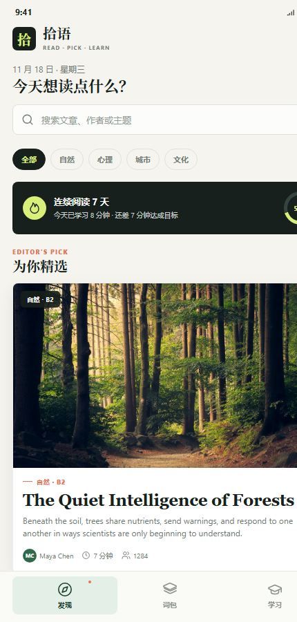

# 拾语 · 英语阅读取词 App 原型

一个 mobile-first 的英语学习产品原型。用户可以在社区阅读英文文章，直接点击正文中的单词查看释义，把单词收进自己的词包，再通过单词卡复习。



## 在线访问

GitHub Pages 部署完成后，可直接访问：

`https://maidongchan.github.io/shiyu-english-reading-app/`

## 已实现流程

- 文章发现：分类、搜索、编辑精选与社区文章列表
- 文章阅读：英文正文、中文对照、阅读进度与收藏入口
- 文章取词：点击任意英文单词，查看音标、词性、释义和原文例句
- 词包管理：选择已有词包、新建词包、保存词义和来源
- 单词学习：先回忆再翻面、朗读、不熟/记住、学习结果统计
- 社区发布：输入标题、主题、难度和英文正文后发布到列表
- 本地持久化：词包、掌握状态和已发布文章保存在 `localStorage`

## 本地运行

需要 Node.js 18 或更高版本。

```bash
node serve.mjs
```

然后打开 `http://127.0.0.1:4173/`。

## 技术说明

- 原生 HTML、CSS、JavaScript，无构建步骤和运行时依赖
- 移动端优先，430px 手机画框用于桌面预览
- 本地图片素材位于 `assets/`
- 这是前端产品原型，账号、云同步和真实社区数据需要后端服务接入

## 素材说明

演示文章配图来自 Unsplash，用于非商业产品原型展示。原始图片来源：

- Forest: `photo-1441974231531-c6227db76b6e`
- Music: `photo-1511379938547-c1f69419868d`
- City: `photo-1519501025264-65ba15a82390`
- Books: `photo-1516979187457-637abb4f9353`

## License

代码以 [MIT License](./LICENSE) 发布。
